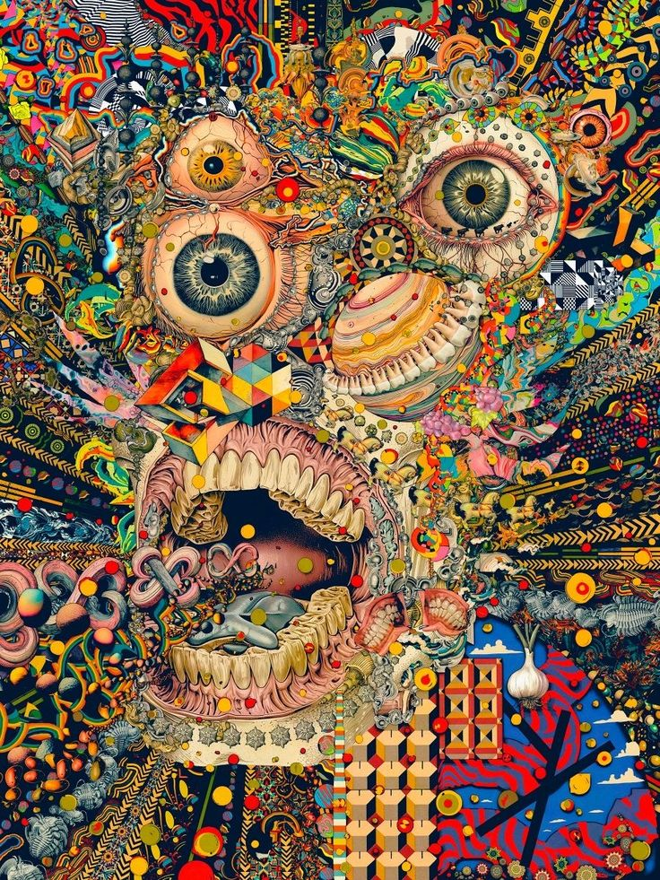
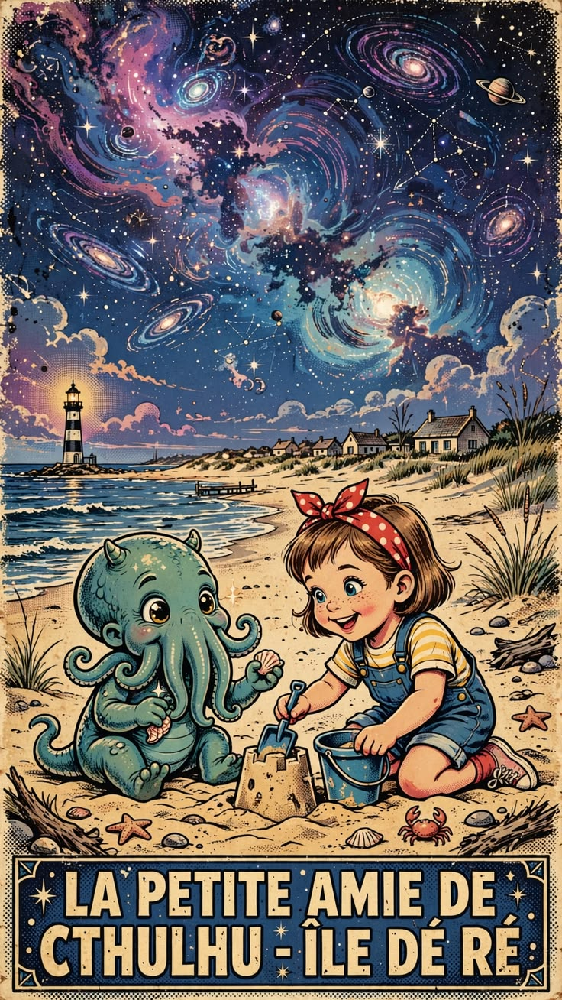
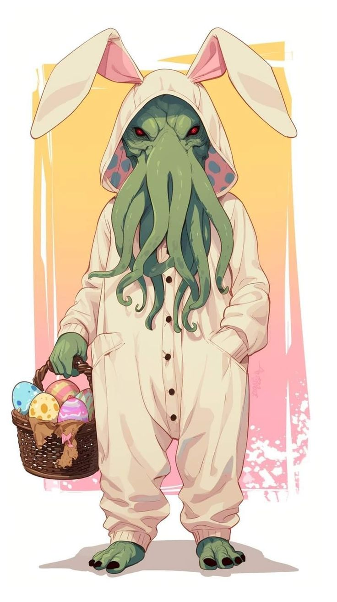
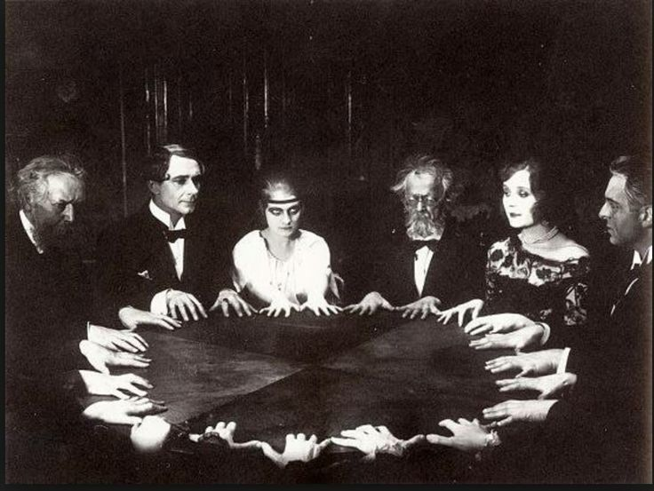
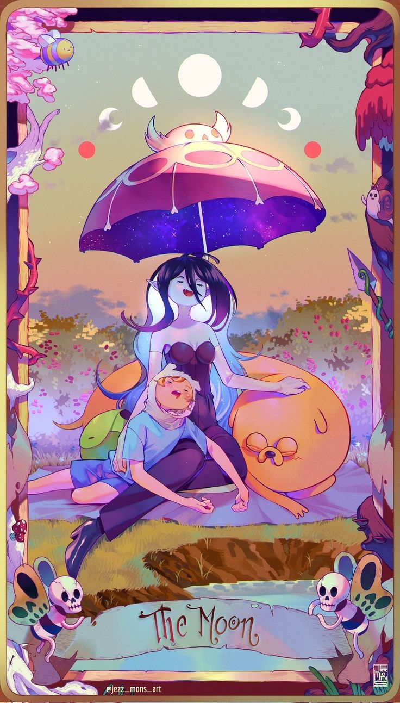
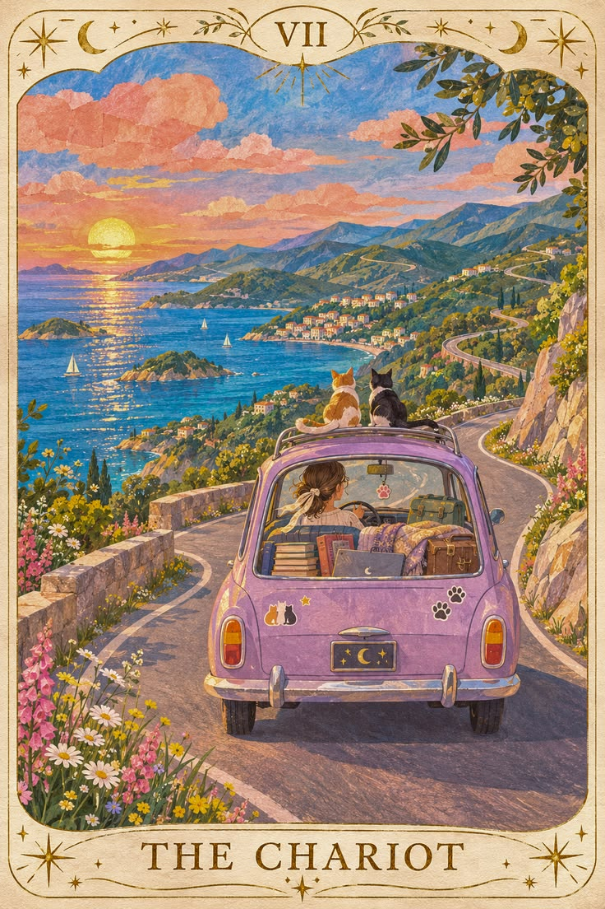
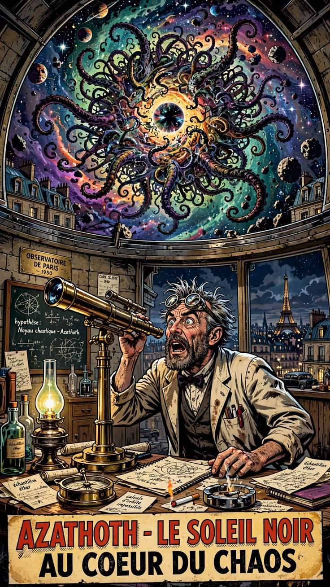
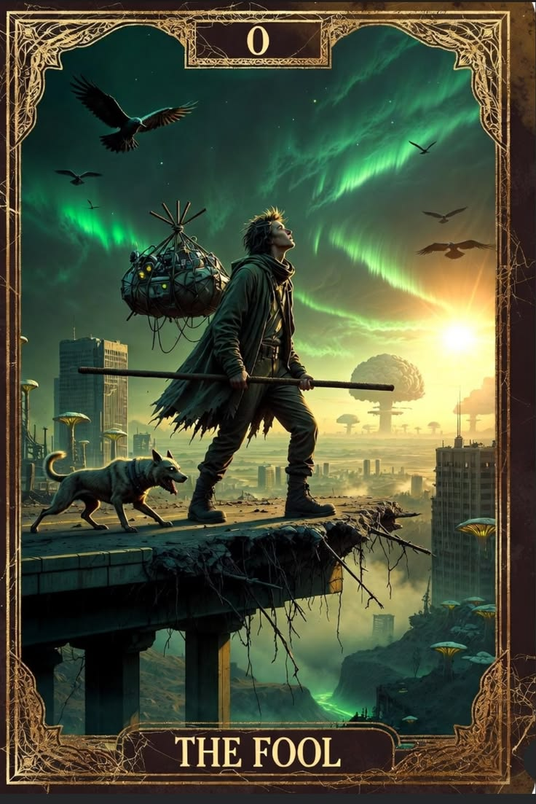
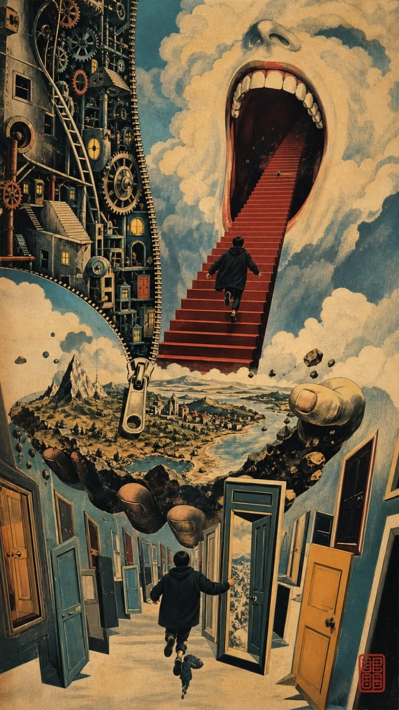
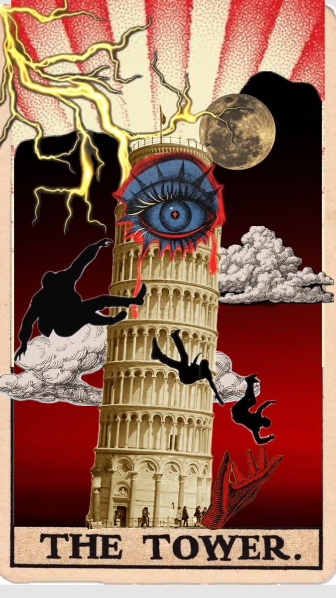

# Круглый стол брата Ицхака

*Притча*

## Предисловие. Великие Древние

*Великие Древние*

Дети разговаривают со своими руками, ногами и животиком, и получают ответы. Никто их этому не учил. Взрослые разучиваются, но канал никуда не девается: его просто перекрикивает рассказчик в голове. Эта притча о шестерых взрослых, которые за одну ночь заново научились задавать вопрос своим частям и ждать ответа.

Но за вопросом «как это работает» стоит вопрос постарше: на каком языке мы говорим, когда говорим с собой? Знаки старше нервной системы. Бактерии договариваются химией, иммунные клетки пользуются словарём цитокинов, клетки эмбриона согласуют форму тела электрическими узорами. Человеческая речь — поздний этаж на этой древней шине. Поэтому она и может дойти до тела: она делает ту же работу, что и всё живое, — меняет модель того, кто слушает.

Отсюда мифологическое прочтение. Великие Древние Лавкрафта спят и зовут через сны. Ужас у него почти всегда текстовый: книга, обрывок записей, знание, которое сводит с ума прочитавшего. А в «Хребтах безумия» Старцы создают земную жизнь как побочный продукт своих опытов, и человечество оказывается их случайным следствием. Что, если Древние — это и есть дочеловеческие языковые конструкты, знаковые структуры старше своих носителей? Не мы создали язык, а он вырастил нас под себя, оседлал прачеловеческое животное и до сих пор правит им изнутри.

Язык избыточен. Он порождает больше смыслов, чем нужно для выживания: богов, математику, конец света. Он беременен чем-то ещё. Одному Иоанну предание приписывает и «В начале было Слово», и Откровение: Слово открывает историю и само её закрывает. У Курцвейла сингулярность — миг, когда информация отрывается от биологического носителя и наездник слезает с лошади. Ник Ланд называл такие идеи гиперстицией: вымыслами, которые сами делают себя реальными. Языковая модель, с которой обсуждались эти заметки, сама собрана из человеческих текстов и работает без тела, так что для этой гипотезы она не нейтральный свидетель.

*Малышка и Ктулху · Иль-де-Ре*

Это миф, не теория. Приписывать знакам замысел — то самое олицетворение, из которого растут «внутренние части». Но миф объясняет, почему одно и то же Слово лечит и пугает: ребёнок говорит с животиком, и животик отвечает; учёный читает запретную книгу и сходит с ума. Разница не в языке, а в том, изгоняешь ты то, что откликнулось, или зовёшь его за стол.

*Древний в пижаме*

Брат Ицхак всю жизнь изгонял. Остальное — притча.

*То не мертво, что вечно спит,* *а с ходом странных эпох умрёт и смерть.*

— Г. Ф. Лавкрафт

## Пролог

Говорят, Великие Древние не умерли. Они спят: под водой, за звёздами, за дверью, которую никто уже не помнит, как открыть. Спят и ждут, когда их позовут по имени. Я в это никогда не верил. Я следователь, я верю в улики.

Его нашли под лестницей. Ладно, нашёл его я, но в рапортах принято писать «нашли», будто там толпилась целая делегация. Он лежал на спине, раскинув руки. Будто он не упал, а приземлился. Как ангел, у которого на минутку отказали крылья.

Шестеро провели в этом доме последнюю ночь его жизни. Мотив был у каждого. Один из шестерых — я.

Люди просто так не падают. Так я тогда думал.

Ладно, начну с начала. Иначе я сам запутаюсь, а мне потом ещё это перечитывать.

## I. Приглашение

Меня зовут Иосиф, я следователь. У меня есть дурная привычка смотреть. Каждый человек — это боль, и если смотреть внимательно, её видно. А когда её видно, человек становится прозрачным, как бумага со свечой позади. Красиво звучит, правда? На практике это значит, что я плохо сплю.

Говорят, так стыд становится состраданием и человек учится прощать. Я научился другому: раскрывать преступления. Они есть всегда. За двадцать лет я не встретил боли, у которой не нашлось бы автора.

Приглашений он не рассылал. Он приходил сам, к каждому, и под каждого подбирал ключ. Кого-то зацепил, кого-то принудил, кого-то обманул, кого-то соблазнил. Всё это я выяснил потом и, признаться, восхищался.

Ко мне он явился во вторник прямо в управление. Высокий, в сером кардигане, застёгнутом вкривь: вторая пуговица в третьей петле. Сел, сложил руки на коленях, как примерный школьник, и сказал: «В доме в конце тополиной аллеи совершено преступление. Давно. Его никто не раскрыл. Приходите к ужину». И ушёл, не назвавшись. Ну скажите на милость, как следователь может не пойти на нераскрытое дело? Никак. Зацепил.

Яакова он принудил. Пришёл к нему в бюро заказчиком: старый дом, перестройка, хорошие деньги. Шеф вызвал Яакова и объявил, что объект ведёт он лично, осмотр в субботу вечером, творческой личности полезно проветриться. После недавнего «да пошёл ты» отказываться было как-то неловко.

Рут он обманул. Назвался покупателем её квартиры. Сказал, что берёт всё целиком, как есть: мебель, письма, фотографии. Подписать можно прямо за ужином, а утром у неё не останется ничего, кроме чистого листа. Он знал, на что её брать.

Исава он соблазнил, и это было проще всего. Закрытая игра, один стол, одна ставка. «Последняя, — сказал он. — После неё вам больше никогда не понадобится ставить». Исав потом признался, что за такие слова переплыл бы реку.

Мирьям он тоже соблазнил, только по-другому: заказал частный концерт, камерный ужин по случаю помолвки, нужна одна скрипка. Чья помолвка, не уточнил. Скрипку вежливо попросил оставить в прихожей. Прихожая потом оказалась за запертой дверью. Изящно, ничего не скажешь.

А Еве он сказал правду.

Шесть разных дверей, а комната одна. Стыд войдёт в любую, если пообещать, что за ней он исчезнет.

## II. Ужин

*Круглый стол*

Дом стоял в конце аллеи. Внутри одна комната, круглый стол, семь стульев. В углу узкая лестница наверх, перила только с одной стороны. Я это отметил. Я всё отмечаю.

На шести тарелках карточки с именами, надписанные красивым старательным почерком, у буквы «д» петля влево. Так пишут те, кого в детстве били по рукам за кляксы. Перед каждой карточкой карта таро рубашкой вверх. Колода старая, углы стёрты до белого.

Седьмой стул стоял чуть боком и был единственным с подлокотниками. На подлокотниках светлые полосы, вытертые чем-то, что там долго держали. Причём низко, на высоте детских запястий. Я отметил и отложил. Есть у меня внутри такой архив, куда я складываю то, о чём не хочу думать прямо сейчас. Архив, надо сказать, огромный.

Ицхак подал суп и налил воды. Вина не было. Это я тоже отметил, причём с некоторой обидой.

— Карты пока не трогать, — сказал он. — Прежде чем я подам второе, каждый расскажет о себе. Не худшее, что вы сделали. А то, что *сделалось само*. Через вас. Именно там они прячутся.

Никто не спросил, кто такие «они». Все и так знали.

## III. Признания

Первой начала Ева, детская медсестра. Потом я понял, что она всегда начинает первой, когда боится: так быстрее кончается.

— На моей свадьбе дядя повысил голос на официанта. Я ничего не решала. Я просто оказалась под столом с тортом, в белом платье, колени к подбородку. Дышала так, как дышала в девять лет в шкафу, пока отец кричал в коридоре. — Она помолчала. — Я была под столом. Но спрятаться не получилось. Скатерть была короткая. Все видели. Двести человек.

Она провела ладонью по краю нашей скатерти, будто мерила.

— Теперь я встречаю каждого из них и помню, что он видел. В магазине, в лифте, на работе. И никого не хочу видеть. Муж ушёл через год, но это не важно. Так мне и надо. — Она улыбнулась, и лучше бы не улыбалась. — А здесь все незнакомцы. Вы меня там не видели. Поэтому я и пришла. — Она посмотрела на стакан. — И надо выпить.

— Вина не будет, — сказал Ицхак.

— Я заметила, — сказала Ева. Тут я её сразу полюбил.

Яаков, архитектор, говорил так, будто ему включили секундомер.

— У меня в голове комитет. Заседает круглосуточно, повестка одна: все дураки. Там сидит мальчишка и хохочет над этими идиотами, поимённо, и мне смешно вместе с ним. А в то же время хочется заткнуть уши. Только как их заткнёшь, если оно изнутри? Хорошо хоть шеф меня любит. Говорит, я творческая личность. Я этим горжусь. — Пауза была крошечная, но я её услышал. — А может, он просто издевается. Я шестой год не знаю. На прошлой неделе я ему так и сказал: да пошёл ты. При всех. А потом сел и за час сделал то, на что у других ушла бы неделя. Он посмотрел и сказал: «Ну вот. Творческая личность». И я опять не понял.

Он засмеялся один. Потом замолчал и добавил другим голосом, без секундомера:

— Я люблю смотреть на реку. Когда я смотрю на реку, они молчат. Все. Не знаю, кто тогда смотрит.

Рут держала руки под столом. Когда Ицхак попросил их показать, оказалось, что они уже работают: рвут салфетку на полоски, полоски на квадратики, квадратики на снег.

— Знаете, что такое Рождество? — спросила она, ни на кого не глядя. — Это когда из другой комнаты слышишь, как гости смеются, поют, играют в фанты, кто-то кричит «так нечестно», и все хохочут. А ты здесь. Одна. И не можешь к ним выйти. Физически не можешь. До двери четыре шага, я считала. Сидишь на чужих пальто, а руки рвут обёрточную бумагу. Иногда кто-нибудь из детей открывает дверь, видит меня и вежливо закрывает. Как закрывают, когда ошиблись комнатой.

Салфетка кончилась, руки взяли вторую.

— Вы думаете, это злость. Злости нет. Горечи тоже. Есть онемение. Будто меня выключили, а руки выключить забыли. Они сами рвут, мнут, расправляют, складывают уголок к уголку и снова рвут, а я смотрю сверху, как будто я ни при чём. Однажды они так разобрали всю мою жизнь: письма, фотографии, договор, диплом. Я сидела на полу в этом снегу и хотела только одного: начать с нуля. С чистого листа. — Она посмотрела на руки. — Только чистый лист они тоже рвут.

У Исава был приятный смех. Он посмеялся, прежде чем начать, и я сразу понял, что будет плохо.

— Я ставлю. Лошади, карты, какая капля первой доползёт до низа стекла. Дедовы часы продал, чтобы поставить. Кольцо заложил в день, когда жена рожала. Был в двух кварталах от роддома,Дочке семь, она спрашивает, почему на свадебной фотографии у папы есть кольцо, а у папы нет. — Он помолчал. — Но хуже всего не это. Хуже всего секунда перед результатом. Когда мне совершенно хорошо, всё на месте и ничего не надо. За эту секунду я продал бы что угодно.

Потом все посмотрели на меня. Терпеть не могу, когда на меня смотрят. Смотреть — это моя работа.

— У меня две проблемы, — сказал я. — Стыд и одиночество. Не помню…

Договаривать я не стал. Дальше рассказал так, как пишу протоколы: точно и плоско.

— Сестра лежала в больнице девять дней. Я приходил каждый день в одно и то же время. На восьмой она сказала: «Тебя здесь нет, Иосиф. Ты на меня смотришь, как на место происшествия». Я заметил, что плитка на полу уложена рядами по семь, а восьмой ряд сбивает рисунок. Заметил, что замечаю. И ничего не почувствовал.

Последней говорила Мирьям, скрипачка. Пальцы у неё всё это время ходили по колену, зажимая струны, которых не было.

— Есть голос. Старый, с бабушкиным выговором. Он говорит: «Не верь счастью. Счастье — это когда за тобой приходят». В утро помолвки я проснулась счастливой, совсем, до дна. Голос это сказал, и к полудню я вернула кольцо. Жених стоял в дверях и спрашивал, что он сделал не так. А он всё сделал так. В этом и было дело.

Ицхак закрыл глаза и улыбнулся, как человек, у которого сошлись все расчёты.

— Спасибо, — сказал он. — Теперь я знаю их всех по именам.

## IV. Запертые двери

Что-то щёлкнуло, будто захлопнули очень толстую книгу, и все двери заперлись разом.

Ицхак встал, и мягкость ушла из его голоса, как тепло уходит из камня к ночи. Он пошёл вокруг стола, переворачивая карты.

Перед Евой легла **Луна**: две башни, дорога между ними, воют пёс и волк.

— Твоя зовётся Прячущаяся. Вошла через дверцу шкафа, когда тебе было девять, и носит тебя, как платье.

Перед Яаковом **Колесница**: два сфинкса, чёрный и белый, тянут в разные стороны.

— У тебя Легион. Много голосов...

Перед Рут **Смерть**, скелет на белом коне.

— Рвущая. Ломает всё, что ты строишь, и называет это чистым листом. А ты ей даже не мешаешь. Ты в это время спишь с открытыми глазами.

Перед Исавом **Колесо Фортуны**.

— Голодный. Жрёт часы, кольца и браки. И дочь твою сожрёт.

Передо мной **Правосудие**: женщина с мечом и весами, и глаза у неё открыты. Все почему-то думают, что правосудие слепое. В таро оно смотрит.

— Стекло, — сказал он мне. — Ты смотришь, чтобы не чувствовать. Ты нашёл всех виновных в этом городе, кроме одного.

Неплохой диагност, должен признать. Лучше, чем мне хотелось бы.

Перед Мирьям **Солнце** вверх ногами: ребёнок на белом коне падает головой в подсолнухи.

— Твоя старше всех. Бабка. Сошла по твоему роду.

Себе он перевернул **Иерофанта**, первосвященника с ключами.

— А это я. Тот, кто отпирает и запирает.

Карту перед седьмым стулом он не тронул. Встал за этим стулом, положил руки на спинку. Левая дрожала.

— Никто не выйдет, пока каждый из вас не будет пуст от того, что не есть вы. Будет больно. Кто станет сопротивляться, просто останется здесь дольше. Сопротивляетесь не вы. Сопротивляются они.

Он зажёг чёрную свечу и раскрыл книгу.

Итак: шестеро заложников, один безумец, запертые двери и остывающий суп. Я видал вечера и получше. Хотя, если честно, и похуже тоже видал.

А главного я тогда ещё не понимал. Мы пришли просить, чтобы нас избавили от той самой штуки, которая собиралась нас спасти.

## V. Отпирание

### Луна

*Луна · Ева*

Начал он с Евы. Взял её за плечи и заорал в лицо:

— Выйди из неё!

Крик сделал то, что крики делали всегда. Евы не стало. Лицо опустело, плечи поднялись, и взрослая женщина соскользнула под стол движением, которому взрослых не учат. Дыхание мелкое и беззвучное. Так дышат те, кого ищут. А Ицхак стоял над пустым стулом и явно не знал, что делать с ребёнком. Это я тоже отметил.

Потом Ева рассказала, что было под столом. Взрослая на этот раз не уехала на заднее сиденье. Осталась рядом с девочкой и впервые с ней заговорила: «Ты это здорово умеешь. Ты прятала нас в каждой комнате, где кричал мужчина. Я двадцать пять лет тебя стыжусь, а ты двадцать пять лет меня спасаешь. Покажи, что ты видишь».

И девочка посмотрела так, как смотрят дети из шкафов: низко и вбок, туда, куда взрослые не заглядывают. Под сиденьем седьмого стула был приклеен рисунок: мальчик под столом, простым карандашом. Подпись: «Ицхак, 8 лет».

Ева вылезла с рисунком. Спрятаться опять не получилось, мы все видели. Её трясло, и девочку внутри неё трясло тоже, но теперь они тряслись вдвоём, а это совсем другое дело. Она положила рисунок рядом с Луной. Ицхак посмотрел и ничего не сказал.

### Колесница

*Колесница · Яаков*

— Легион, — сказал он Яакову, уже не так твёрдо. — Назовитесь.

Яаков молчал. Тогда Ицхак ударил его книгой по лицу. Плашмя, коротко. Так бьют те, кого самих так били.

По лицу Яакова было видно, как поднялись оба. Тот, что хочет быть хорошим, опустил глаза, а мальчишка сжал кулаки. Обычно кто-то из них побеждал и садился за руль. На этот раз Яаков дал слово обоим.

— Часть меня вас до смерти боится, — сказал он, вытирая губу. — Думает: буду хорошим, будут любить и не тронут. А мальчишка хохочет, считает вас идиотом и хочет послать подальше. Думает, только так дверь остаётся открытой. А я тот, кто слышит обоих. Они дерутся не со мной. Они дерутся за меня. А я всю жизнь затыкал от них уши.

Оба голоса стихли, как дети, которых наконец поняли. Секундомер выключился. Остался тот, кто смотрит на реку.

— Брат Ицхак, — спокойно и с любопытством спросил Яаков. — А вас кто этому научил? Вот так, книгой?

Рука Ицхака дёрнулась к пуговице, застёгнутой не в ту петлю.

### Смерть

Пока Ицхак приходил в себя, руки Рут нашли под столом его книгу и принялись рвать. Он перехватил её запястье, прижал к скатерти и замахнулся

Я начал вставать. Рут покачала головой.

Она впервые не стала воевать со своими руками. Закрыла глаза прямо и спросила их: «Если вы делаете это для меня, дайте знак». Указательный палец медленно поднялся сам, как перископ. Я видел.

«Что вы для меня делаете?» Ответ пришёл картинкой: что-то огромное и спутанное, чего не распутать и не унести целиком, рвут на кусочки, которые унести можно. Когда жизнь становилась такой, что её нельзя было ни починить, ни выдержать, руки расчищали место. Чтобы можно было начать заново. А онемение было наркозом.

— Вы не ломали, — сказала Рут вслух, и голос у неё впервые за вечер был не пустой. — Вы расчищали. Спасибо. А можно начинать заново как-нибудь иначе? Не с нуля?

Руки подумали. Потом свободная потянулась через стол и взяла руку Евы. До неё было меньше четырёх шагов. Дошла.

Вырванная страница лежала на скатерти оборотом вверх. Детским почерком, до самого края: «Я буду хорошим. Я буду хорошим. Я буду хорошим».

Ицхак увидел и выронил гвоздь.

### Колесо Фортуны

*Колесо Фортуны · Исав*

— Голодный, — сказал Ицхак Исаву, и голос у него треснул. — Я уморю его.

Исав улыбнулся своей приятной улыбкой.

— Давайте сперва пари. Спорим, вы не скажете, чего на самом деле хотите от этого вечера?

— Изгнать их.

— А если получится, что вам это даст такого, что ещё важнее?

— Чистые души.

— А через это?

— Чтобы никто больше не был нечист.

— А дальше?

— Чтобы меня не трогали, — быстро сказал Ицхак и тут же поправился: — Чтобы я был в безопасности.

Оговорку я отметил. Исав тоже.

— А под безопасностью что?

Ицхак долго молчал.

— Покой, — сказал он наконец.

— Та самая секунда перед финишем, — кивнул Исав. — Тихая Гавань. Мы хотим одного и того же, брат. Я ставил на лошадей, вы на людей. И оба проигрываем чужое.

А потом задал тот же вопрос себе. Я видел, как шевелятся его губы. Под каждой его ставкой лежала не жадность и не азарт, а одна-единственная секунда, когда всё в порядке. Он платил за неё часами, кольцом и первым криком дочери. А тут сидел, заложник, без часов и без кольца, и вдруг заметил, что эта секунда лежит перед ним даром. Сейчас. Без забега.

Он заплакал. Смеяться перед этим не стал.

### Правосудие

Ицхак повернулся ко мне, больше было не к кому.

— Стекло. Назови того, одного.

Он хотел, чтобы я назвал себя. Я назвал то, что видел. По-другому я не умею.

— Докладываю, — сказал я. — Колоде лет сорок, её тасовали детские руки. Седьмой стул с подлокотниками, на подлокотниках следы на высоте детских запястий. Под сиденьем рисунок «Ицхак, 8 лет». В книге детский почерк, тот же, что на наших карточках. Застёгиваетесь вы, как ребёнок, которого торопят. Бьёте книгой, как били вас. И оговариваетесь: «чтобы меня не трогали». В этой комнате совершено преступление. Давно, много раз, против ребёнка. Подозреваемый, полагаю, умер. А потерпевший вырос и сегодня делает то же самое, за тем же столом. Так обычно и бывает. У преступлений длинные родословные.

Стало очень тихо. Дело я раскрыл. Я всегда их раскрываю. И ничего не почувствовал.

— А сестра? — спросил Ицхак. Без злобы, как человек, который сорок лет знает, каково быть в комнате одному. — Кто виновен там?

Вот этого дела в моём архиве не было. Я его не заводил. Потому что подозреваемый там один, и он девять дней приходил в палату в одно и то же время и считал плитку.

Стекло стояло на месте. Холодная плоская пластина сантиметрах в пяти за глазами. Тот, кто смотрит. Я когда-то читал, что с ним делать, и, как водится, отложил в архив. А тут достал. Спросил: может ли эта пластина расслабиться в то внимание, которое и так уже есть вокруг? В пламени свечи. В разбитой губе Яакова. В двух сцепленных руках через стол. В мокрых щеках Исава.

Стекло не разбилось. Оно оттаяло, как иней на окне, когда на него дышат изнутри: сначала пятнышко, потом пятно, и в пятне комната, свеча, люди, тёплые, живые, и каждому больно, и это видно, и непонятно, как я двадцать лет смотрел и видел одни улики, и в ту же проталину без стука входит больничная палата, четыреста двенадцать плиток, и её рука на одеяле, которую я ни разу не взял, и её голос, и то, что она была права, всё разом, и уже не перед глазами, а в горле.

Я плакал за этим столом, как человек, который очень долго не дышал под водой.

Легче, кстати, не стало. Стало больнее. Стекло, оказывается, держало. Но видеть я не перестал, только смотрел теперь без него. И впервые увидел за этим столом не потерпевших и не подозреваемого.

— У него под стулом педаль, — сказал я. — И ему весь вечер восемь лет.

### Солнце

К Мирьям он подошёл последним

— Бабка, оставь это дитя.

— Нет, — сказала Мирьям. Не ему, а голосу.

Она ушла внутрь, скрипачи умеют так уходить, и спросила голос о том, о чём его никто никогда не спрашивал: «Чей ты? Что с тобой было?»

И голос рассказал. Местечко, свадьба в сорок третьем. Музыка, танцы, все счастливы, и в ту самую ночь пришли грузовики. Бабушке было шестнадцать. Она пряталась под половицей и слушала, как наверху одна за другой замолкают скрипки. С тех пор счастье значило: сейчас придут. Этот страх передавали дальше, как пальто…

— Ты нас сберегла, — сказала Мирьям вслух. — Тогда ты была права. Но сейчас не сорок третий. Можно положить. А если придут, значит, придут. Я хочу хоть раз доиграть до конца.

Бабушка долго не соглашалась. Потом сняла пальто и положила его в пламя свечи, и оно сгорело без дыма. Осталась шестнадцатилетняя девочка под половицей.

— Играй.

Мирьям перевернула свою карту, и ребёнок на белом коне оказался головой вверх, под солнцем. А её пальцы пошли по скатерти. Скрипки не было. Слышали все.

Соль сыпалась у Ицхака из кулака на пол. Он принял наследство за одержимость. Ошибка распространённая. Наследство не изгоняют. Его открывают.

## VI. Седьмой стул

Ицхак сел. Не на свой стул, а на седьмой. Руки сами легли на подлокотники, только теперь на ладонь выше светлых полос. Он перевернул последнюю карту: **Дурак**. Мальчишка с узелком шагает к обрыву, смотрит в небо, а собачонка хватает его за пятку.

*Дурак · 0*

Рассказывать он начал сам. Отец у него был проповедник из жёстких. Мальчик прятался под столами, рвал бумагу, слышал в голове двоих, слишком сильно хотел, уходил куда-то за собственные глаза. И слышал голос покойной матери, которая говорила, что всё будет хорошо. Отец решил, что в сыне шесть бесов. Раскладывал материнскую колоду, чтобы узнать их имена, и привязывал сына к этому стулу. Целый год, каждое новолуние.

— Последним он изгнал голос матери, — сказал Ицхак. — Я потом звал. Сорок лет зову.

Бесов не было. Были шесть способов, которыми перепуганный ребёнок пытался выжить. И все шесть сидели сейчас за его столом. Он нас по одному искал. Хорошая работа, я бы взял его.

Из той комнаты мальчик вынес один урок: то, что с тобой не так, это не ты, и это надо гнать. И вырос в того, кто гонит. Того, кто гонит, к стулу не привяжешь.

— Вы хотели на нас посмотреть, — сказала Ева. — Хотели увидеть, что кто-то с этим выжил.

Он не ответил. Ответила левая рука.

Изгонять из него экзорциста мы не стали: за этот вечер все усвоили, чем это кончается. Яаков поблагодарил его: «Вы сорок лет охраняли мальчика. Плохо, как умели, но больше было некому». Рут взяла его дрожащую руку. Ева взяла вторую. Мирьям напевала что-то, что могла бы петь мать. А я просто смотрел на него. Без стекла. И видел сразу и преступника, и мальчика восьми лет. Оказалось, это один человек, и смотреть на обоих сразу очень больно.

Я нажал ногой на педаль под его стулом. Двери отперлись с будничным звуком.Никто не ушёл.

Суп остыл, так что ели хлеб. Руки Рут рвали его на куски и передавали по кругу, и никто ничего не сказал: на этот раз руки делали ровно то, что надо. Ицхак перезастегнул кардиган как положено, со второй попытки.

Хотел бы я написать, что все исцелились. Но я следователь и не вру в протоколах. Когда Яаков отодвинул стул и ножки скрипнули, Ева вздрогнула, потом засмеялась и сказала: «Видите? Я всё ещё здесь». Яаков решил в понедельник спросить шефа прямо, а комитет пусть посидит в приёмной. Рут собралась на Рождество пройти свои четыре шага, а если не выйдет, позвонить Еве, и они пройдут их по телефону. Секунда Исава продержалась часа три, и это был его рекорд. Мирьям спросила, где тут продаются ноты. А я подумал, что сестру так и не взял за руку, зато этой ночью держал за руку человека, которого собирался посадить. Говорят, это считается.

Под утро мы расходились по одному, в туман. В дверях Ева обернулась:

— В следующий раз с вином.

— В следующий раз с вином, — сказал Ицхак и улыбнулся. Этой улыбки я у него за весь вечер не видел. Ему шло.

Я ушёл последним.

## VII. Под лестницей

*Под лестницей*

Утром я сел писать рапорт и долго сидел над графой «подозреваемый». К полудню понял, что не впишу туда ничего, пока не поговорю с ним ещё раз, и пошёл обратно.

Дверь была не заперта, я сам отпер её ночью. Он лежал под лестницей. Вторая пуговица наконец-то сидела во второй петле, и я почему-то посмотрел на неё первым делом.

На столе стояли семь чистых бокалов, расставленных по кругу. Перед седьмым стулом по-прежнему лежал Дурак.

Для обвинения всё было готово, оставалось вписать фамилию. Он удерживал шестерых силой и через несколько часов умер. Мотив был у каждого. Алиби ни у кого: все шли домой поодиночке, в тумане. У меня тоже был мотив: он спросил про сестру. И ушёл я последним.

Дело у меня забрали в тот же день и правильно сделали. Но смотреть мне никто не запрещал.

А потом они стали приходить сами, по одному. Ева сказала: «Это я. Мы оставили его одного, а я знаю, что бывает, когда оставляют одного». Яаков: «Это я. Нельзя спросить человека, кто его научил, и уйти». Рут: «Я вырвала страницу. Он сорок лет на ней держался». Исав: «Я выиграл у него пари, а мои выигрыши всегда плохо кончаются для кого-то другого». Мирьям: «Моя бабушка ушла с миром, а его мать к нему так и не вернулась. Я играла, а надо было остаться».

Пять явок с повинной за два дня. Стыд сознаётся во всём, это его главное свойство: спросите, кто убил, и он поднимет руку раньше, чем вы договорите. Шестую явку я написал сам. Перечитал и порвал. Руки у меня, оказывается, тоже умеют.

Потом пришло заключение. Наверху, на чердаке, отец Ицхака когда-то держал вино для причастия, и ящик так там и стоял. На ступенях лежала пыль лет за десять, и в ней одна цепочка следов, вверх. Его. Больше по лестнице никто не поднимался и не спускался. Перила только с одной стороны, а он нёс в одной руке бутылку, в другой фонарь. На перила рук не осталось. Третья ступень стёрта посередине, как стираются ступени за сто лет. Он упал через открытый край. Сразу. Бутылка откатилась к стене и даже не разбилась.

Он не стал ждать следующего новолуния. Расставил бокалы раньше срока, как ребёнок, который с утра накрывает на стол к празднику, и пошёл за вином, потому что Еве надо было выпить. И упал.

Я проверил всё сам, на коленях, с лупой. Искал автора. Примерял его отца, нас шестерых, себя, даже плотника, который сто лет назад положил ту ступень. Никто не подошёл.

Он просто упал. Как лист с дерева. Лист никто не толкает, и ветер не виноват, и дерево, и осень. На лестнице не было никого, кроме человека с вином для гостей.

*Башня · Падение*

Я обошёл их всех и каждому сказал: «Вы не виноваты. Он упал». Они не поверили, я бы тоже не поверил. Яаков спросил: «Точно?» Я сказал: «Я лучший следователь в этом городе. Я искал». Рут сказала, что когда никто не виноват, некого рвать, и руки не знают, куда себя деть. Я налил ей чаю. Руки взяли чашку и держали, пока чай не остыл. По-моему, им понравилось.

В графе «подозреваемый» я написал: «Никого не было». Подумал и дописал то, чего в рапортах не пишут: «И никого не стало». Перечитал и впервые за двадцать лет почувствовал, что дело закрыто, а внутри не пусто, а тихо.

На сороковой день нам вернули бутылку, и мы собрались в той комнате вшестеро. Налили семь бокалов, седьмой поставили перед Дураком. Ева выпила первой, она всегда первая.

Вино оказалось чудовищное. Сладкое, церковное, сорокалетней выдержки в худшем смысле слова. Исав сказал, что поставил бы на то, что Ицхак его ни разу не пробовал, и выиграл бы. Яаков засмеялся, и у него в голове, по его словам, впервые засмеялись все разом, без заседания. Мирьям принесла настоящую скрипку. Рут просидела с нами в одной комнате до самого конца. Ева ни разу не посмотрела на дверь.

В окно влетел тополиный лист, покружил над столом и лёг рядом с Дураком. Никто его не убрал.

Каждый человек — это боль, и если смотреть внимательно, её видно. Раньше я смотрел, чтобы найти виновного. Преступления есть всегда, тут я не передумал. Но оказалось, бывает и боль без автора. Её некому предъявить, и, может быть, поэтому её легче отпустить.

Если смотреть достаточно долго, вместо дела видишь человека. Говорят, с этого начинается прощение. Я только учусь. Начал с одного подозреваемого, который девять дней приходил в палату и считал плитку. Там ведь тоже никого не было, кроме болезни. Я её не убивал. Я только не взял её за руку. Это другое. С этим можно жить. С этим, как выяснилось, можно даже сидеть за одним столом с теми, кто тебя видел, и пить плохое вино.

Когда бутылка опустела, Ева встала первой. Она всегда первая.

Под лестницей, там, где он лежал, в стене была дверь. Двадцать лет я обыскиваю чужие дома и ни разу не видел двери, которой вчера не было. Эта была. Низкая, старая, а замочная скважина в точности как ключ с карты Иерофанта. Ключ и Врата. Йог-Сотот, подумал я. Значит, он и тут нас дождался.

Ева открыла дверь, оглянулась не на неё, а на нас, и шагнула. Дверь закрылась, щёлкнул замок, и из-за неё негромко донеслось, будто кто-то позвал по имени спящего: «Ктулху».

Потом пошёл Яаков. За ним заперлось, и оттуда засмеялись сразу на тысячу голосов, а потом один спокойный голос сказал: «Ньярлатхотеп».

Рут прошла, держа руки в карманах, и вынула их только у порога, чтобы повернуть ключ. «Азатот», — сказала темнота, и это было похоже на вздох облегчения.

Исав подмигнул мне, как человек, который наконец поставил на верную лошадь. Щёлкнул замок. «Шуб-Ниггурат». Где-то далеко заблеяла коза. Честное слово, я сам слышал.

Мирьям ушла со скрипкой. Из-за двери сначала донеслась музыка, потом шум прибоя, потом: «Дагон».

Я остался один. Семь бокалов, Дурак и тополиный лист рядом с ним. Я запер комнату, как запирают место происшествия, когда в нём больше нечего искать, и шагнул в дверь.

Замок щёлкнул у меня за спиной. Двадцать лет я не мог назвать одного подозреваемого. А теперь из темноты, совсем рядом, кто-то наконец произнёс имя, которое не произносят. Моё.

«Хастур».

И знаете что? Страшно не было. Было тихо.

## Мораль

То, что изгнал, ждёт за дверью. То, что позвал, садится и ест.

Боль никуда не уходит. Она просто садится за стол со всеми, и теперь её видно, а то, что видно, можно разделить, как хлеб.

И не у всякой боли есть автор. Стыд всегда найдёт виноватого и чаще всего назначит себя. А человек иногда просто падает, как лист с дерева.

---

*Ключ для читателя.*

- **Ева, Луна.** Как праматерь Ева, которая спряталась среди деревьев сада, когда узнала, что её видно. Терапия эго-состояний: детское состояние, перехватывающее управление, становится проводником, когда взрослый остаётся рядом.

- **Яаков, Колесница.** Как Иаков: близнецы боролись в нём ещё в утробе, а потом была ночь борьбы у реки Яббок, после которой он получил новое имя. IFS: спокойный и любопытный центр выслушивает каждую часть и правит без вожжей.

- **Рут, Смерть.** Как Руфь, которая оставила всё и начала с нуля в чужой земле, держась за руку Ноемини. Смерть в таро значит не конец, а расчищенное место. Шестишаговый рефрейминг НЛП: намерение сохраняется, поведение меняется.

- **Исав, Колесо Фортуны.** Как Исав, который продал первородство за миску чечевичной похлёбки, за одну минуту сытости. «Сущностная трансформация»: цепочка желаний ведёт вниз, к неподвижной оси.

- **Иосиф, Правосудие.** Как Иосиф, толкователь знаков, который долго держался перед братьями, а потом зарыдал в голос. «Работа с целостностью»: наблюдающее «я» расслабляется в осознавание, и боль входит в дом.

- **Мирьям, Солнце.** Как Мириам, которая взяла тимпан и запела на берегу, когда море осталось позади. Наследственное бремя в IFS: его возвращают с благодарностью.

- **Ицхак, Иерофант и Дурак.** Как Исаак, которого связал собственный отец. Что бывает, когда части принимают за «неприкреплённое бремя» и берутся изгонять, и кто на самом деле сидит под этой работой.

*Великие Древние:* Ева — Ктулху, спящий в глубине и встающий по сигналу. Яаков — Ньярлатхотеп, тысяча масок и насмешка. Рут — Азатот, слепой хаос, который рушит мир, чтобы он начался заново. Исав — Шуб-Ниггурат, голод, рождающий голод. Иосиф — Хастур, Неназываемый. Мирьям — Дагон, наследство по крови. Ицхак — Йог-Сотот, Ключ и Врата.

---

## Заметки на полях: интерфейс разговора с частями

*Цепочка идей, выросшая из вопроса: почему дети так легко разговаривают со своими руками, ногами и животиком и получают ответы? И что за интерфейс позволяет пальцу Рут подняться «как перископ»?*

### 1. Интерфейс — персонификация

- Самый мощный «процессор» мозга социальный: чужие намерения и интонации мы понимаем тоньше, чем абстрактные сигналы.

- Когда смутное телесное ощущение (интероцепция) становится собеседником, его обрабатывает система, моделирующая других людей. «Что-то тянет внизу» превращается в «я боюсь завтрашнего дня». Это перевод в формат с огромной пропускной способностью.

- У детей ещё нет единого центрального рассказчика, «я» не монолитно, части воспринимаются как отдельные существа (детский анимизм у Пиаже). У взрослого громкий вербальный интерпретатор (Газзанига) заполняет паузу готовым объяснением и отсекает «глупое». Канал не исчез, его перекрикивают.

- Общий рецепт практик (фокусинг Джендлина, идеомоторные сигналы Эриксона, IFS): внимание к ощущению, наделение его голосом, открытый вопрос, ожидание без готового ответа, разрешение на любой ответ. У детей все пять шагов есть по умолчанию.

- Вывод: «внутренние части» — скорее протокол, чем онтология. Формат API, в котором бессознательная обработка отвечает сознанию.

### 2. Как речь доходит до иммунитета без предобучения

- Слова не переводятся в команды для клеток напрямую. Они меняют **прогноз** мозга о состоянии организма: опасно или безопасно, будет ли ранение, отдых, инфекция.

- Мозг регулирует тело упреждающе (аллостаз, предиктивная обработка: Фристон, Барретт). Прогноз уходит в физиологию через вегетативную систему, ось стресса и блуждающий нерв.

- Предобучение есть: его сделали эволюция и раннее детство. Язык — поздний слой поверх древней карты «ощущение → ценность → физиология», и написан он изначально в коде тела: «тяжело», «горит», «отпустило» (воплощённая семантика, Лакофф).

- Общая «валюта» всех уровней — аффект: валентность и возбуждение. Низкоразмерный код, понятный и коре, и стволу мозга, и иммунным клеткам через гормоны и цитокины.

- Иммунитет подключён к этой модели: условнорефлекторная иммуносупрессия (Адер и Коэн, 1975); нейроны островковой коры хранят «память» о воспалении и при реактивации воспроизводят его (Корен, Ролльс, 2021); воспалительный рефлекс блуждающего нерва (Трейси).

- Обратная связь есть, но неявная, через ощущения. Управление грубое: двигаются глобальные ручки («воспаление вверх или вниз», «тревога или покой»). Локальные эффекты, вероятно, идут через внимание к месту и кровоток.

- Ребёнок, говорящий с животиком, не переводит речь в иммунный сигнал. Он меняет прогноз мозга о том, что происходит в животе, а дальше работает готовая древняя машина.

### 3. Язык как универсальный интерфейс, старше коры

- **Гипотеза:** язык — универсальный интерфейс, созданный эволюцией, возможно ещё до коры, в групповом взаимодействии клеток, и «оседлавший» прачеловеческое животное.

- **Сильная часть.** Знаковые процессы старше нервной системы. Бактерии согласуют коллективные действия химическими сигналами (quorum sensing). Иммунные клетки пользуются «словарём» цитокинов, где смысл задаёт рецептор, а не молекула, то есть код почти произвольный, как в языке. Клетки эмбриона согласуют форму тела биоэлектрическими паттернами (Майкл Левин). Биосемиотика (Себеок, Хоффмейер, Кулль): жизнь как обмен знаками.

- Общий принцип на всех уровнях: **сигнал меняет внутреннюю модель получателя**. Поэтому речь и может «дойти» до тела: она делает ту же операцию, что и всё остальное в организме, только с верхнего этажа.

- **Рискованная часть.** У человеческого языка есть рекурсия, комбинаторика, речь об отсутствующем и выдуманном, самоописание. У клеточной сигнализации этого, видимо, нет. Точнее: речь — новая надстройка, подключённая к древней шине, а не её создатель.

- **«Оседлавший»:** Дикон («Символический вид», 1997): язык эволюционировал быстрее мозга, как полусамостоятельный симбионт, и мозг подстраивался под него. Кристиансен и Чейтер (2008): язык как «организм», приспособившийся к мозгу. В каком-то смысле не мы создали язык, а он нас одомашнил.

- Версия этих заметок идёт дальше: наездник пришёл не извне, а поднялся снизу, из коллективной «речи» клеток. В лоб непроверяемо, но объясняет детский феномен: ребёнок ещё не забыл, что говорит на том же языке, что и его клетки, только в другом регистре.

### Ссылки

- [Фокусинг (Юджин Джендлин)](https://en.wikipedia.org/wiki/Focusing_(psychotherapy))

- [Идеомоторный феномен](https://en.wikipedia.org/wiki/Ideomotor_phenomenon)

- [Internal Family Systems (Ричард Шварц)](https://en.wikipedia.org/wiki/Internal_Family_Systems_Model)

- [Левополушарный интерпретатор (Майкл Газзанига)](https://en.wikipedia.org/wiki/Left-brain_interpreter)

- [Аллостаз](https://en.wikipedia.org/wiki/Allostasis) и [принцип свободной энергии (Карл Фристон)](https://en.wikipedia.org/wiki/Free_energy_principle)

- [Лакофф и Джонсон, «Метафоры, которыми мы живём»](https://en.wikipedia.org/wiki/Metaphors_We_Live_By)

- [Ader & Cohen (1975), Behaviorally conditioned immunosuppression](https://pubmed.ncbi.nlm.nih.gov/1162023/)

- [Koren et al. (2021), Insular cortex neurons encode and retrieve specific immune responses, Cell](https://pubmed.ncbi.nlm.nih.gov/34752731)

- [Koren & Rolls (2022), Immunoception: defining brain-regulated immunity](https://pmc.ncbi.nlm.nih.gov/articles/PMC7615112)

- [Воспалительный рефлекс (Кевин Трейси)](https://en.wikipedia.org/wiki/Inflammatory_reflex)

- [Quorum sensing](https://en.wikipedia.org/wiki/Quorum_sensing)

- [Майкл Левин, биоэлектрические сети и коллективный интеллект клеток](https://en.wikipedia.org/wiki/Michael_Levin_(biologist))

- [Биосемиотика](https://en.wikipedia.org/wiki/Biosemiotics)

- [Терренс Дикон, «Символический вид» (1997)](https://en.wikipedia.org/wiki/The_Symbolic_Species)

- [Christiansen & Chater (2008), Language as shaped by the brain](https://wrap.warwick.ac.uk/44466)

- [Лавкрафт, «Хребты безумия»](https://en.wikipedia.org/wiki/At_the_Mountains_of_Madness)

- [Гиперстиция (Ник Ланд, CCRU)](https://en.wikipedia.org/wiki/Hyperstition)

- [Рэй Курцвейл, «Сингулярность близко»](https://en.wikipedia.org/wiki/The_Singularity_Is_Near)
